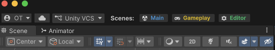

# Color Block Jam – Vertical Slice

A small vertical slice of Color Block Jam in Unity: a playable level flow and a level editor.

**[English](#english) | [Türkçe](#türkçe)**

---

## English

### How to open and run

1. Open the project with **Unity 2022.3.62f2**.
2. Open `Assets/Scenes/SampleScene.unity` (boot + home screen) and press **Play**.
   Play always starts from this scene, whichever scene is open.
3. Press the level button on the home screen to start the current level.

**Video:** the full game flow (about 2.5 minutes).

https://github.com/user-attachments/assets/d2abdf04-d4dc-4b06-a03c-7a935ddca2bb

### How to open the editor and make a level

Press **Editor** in the scene buttons at the top left of the Unity toolbar. It opens `EditorScene`, where the
level editor works directly in the Scene view.

**Video:** making a level in the editor (about 3 minutes).

https://github.com/user-attachments/assets/9ed86082-5f14-4415-91dc-da64e29c5aa0

1. In the level bar at the top, press **New** (or pick an existing level).
2. Set the board size (width / height) and the timer in the level bar.
3. Pick the **Block** tool and paint cells to place blocks; pick a colour from the palette.
4. Pick the **Gate** tool and click a wall slot to place a door.
5. Problems (an error blocks Save) are listed in the card at the bottom right.
6. Press **Save**, then **Play** to play the level right away.

> **Note:** **Play** in the level bar opens the game straight into the level you are editing: no need to go
> through the home screen, and no life is spent.

**Shortcuts** (in the Scene view or the Level Editor window; `Ctrl` or `Cmd`):

| Key | Action |
|-----|--------|
| `1` / `2` / `3` / `4` | Select / Block / Gate / Cell tool |
| `Shift` (held) | Flip the tool's add / erase mode |
| `Shift` or `Ctrl` + click | Add to the selection (Select tool) |
| `R` | Rotate the selected blocks |
| `Ctrl + D` | Duplicate the selection |
| `Ctrl + C` / `Ctrl + V` | Copy / paste blocks |
| `Delete` / `Backspace` | Delete the selection |
| `Ctrl + S` | Save the level |
| `Esc` | Clear the selection (or cancel the eyedropper) |
| `Ctrl + Z` / `Ctrl + Shift + Z` | Undo / redo (Unity's own) |

The editor can also be opened from `Tools > Level Editor > Open Level Editor`. The game and the editor read and
write the same `LevelData` asset.

### Architecture decisions

#### Packages

- **VContainer** – dependency injection. I chose an MVC-style split (data, logic, view) because it keeps a small
  team fast and stays easy to extend later. VContainer is ahead of its alternatives in allocations and is
  actively maintained for current Unity versions.
- **Own pool system** – to go with VContainer I wrote a pool (`Assets/_Game/Core/_Script/Pool`) shaped like
  Zenject's `MemoryPool`, so it is easy to use: `IMemoryPool<T>`, `Spawn` / `Despawn`, `IPoolable`.
- **MessagePipe** – messaging between systems, similar to Zenject's SignalBus but with fewer allocations, so
  better for performance.
- **UniTask** – coroutines are slow and tied to the main loop, so the two ways out are C# `Task` or UniTask.
  I chose UniTask because it is the best task system for Unity today and offers more Unity-specific features.
- **DOTween** – the industry standard for tweens. I considered PrimeTween, which would fit this low-allocation
  setup better (or another package built like it), but since I have not used it much I picked DOTween to get a
  more optimal result instead of risking wrong usage.
- **Audio Manager Pro (SFXManager)** and **MOST Haptic Feedback** – sound and haptics, added to make the case feel
  more polished and stable. Game code reaches them only through `IAudioService` and `IHapticService`.

#### Structure

- **One core entry point.** `ApplicationController` starts the core systems in order (storage, player, life,
  currency, services, screens) and owns the level flow, so the game stays in a controlled state.
- **Gameplay as an additive scene.** The main scene holds the core; the gameplay scene is loaded additively on top of
  it. The core is loaded once at start, and the gameplay code stays separate from the core. Another game can reuse
  the core by replacing only the mechanic code.
- **SandBox area.** All gameplay and board code lives in `Assets/_Game/SandBox` (separate assemblies; the board rules
  have no Unity references and are covered by EditMode tests). SandBox depends on Core, Core never depends on
  SandBox; they talk only through MessagePipe signals. This also keeps LLM-assisted work on gameplay from breaking
  the core.
- **Settings as ScriptableObjects.** Tunables (timings, prices, colours, camera) live in settings assets, not in code.

#### Scope decisions

- **Popups** (level complete, out of time, quit, level failed, more lives, collect) were added to complete the game
  flow.
- **Shop** is an optional decision: the shop page shows coin packs and a bundle, but it is **not connected to IAP**.
  Buying an offer only grants its rewards through the Collect popup.
- Optional scope done: functional boosters, ice blocks, arrow (one-way) blocks, ice gates, level validation and a
  level solver in the editor.

### Known problems

- Level editor: when a block is split in the middle (erasing cells so it falls into two separate pieces), it still
  behaves as one block instead of becoming two.

### Incomplete parts

- Popups are visually basic.
- Particle effects are missing in most places.
- There are only a few sound effects.
- After a life is lost, nothing shows how many seconds are left until the next life refills.
- A coin count above 100,000 does not fit its text field.
- The Vacuum booster's animation is incomplete: the supplied assets have no animated vacuum object for it.
- The Timer booster has no ice effect over the level timer while the clock is frozen.
- The level win screen has no fireworks or similar celebration particles behind it.
- The home screen's level path (the level nodes and their locks) is visually incomplete and not right yet.

### LLM tools

- **Claude** (main agent): wrote all gameplay and tool (level editor) systems; for the core structures it built the
  view parts.
- **Levels:** levels 1–5 were set up by hand in the level editor. Levels 6–20 follow the reference video
  (https://www.youtube.com/watch?v=QLtwVTGiVho): the video was watched through Orchestra with Gemini, the extracted
  level data was passed to Claude, and the levels were brought into the game with the level editor tooling.

### Approximate work time

About 3 full days (7–8 hours each) and 3 days of 1–2 hours.

---

## Türkçe

Color Block Jam'in Unity'de küçük bir dikey kesiti: oynanabilir bir level akışı ve bir level editörü.

### Projeyi açma ve çalıştırma

1. Projeyi **Unity 2022.3.62f2** ile açın.
2. `Assets/Scenes/SampleScene.unity` sahnesini (açılış + ana ekran) açıp **Play**'e basın.
   Hangi sahne açık olursa olsun Play her zaman bu sahneden başlar.
3. Ana ekrandaki level butonuna basarak güncel level'ı başlatın.

**Video:** oyunun tüm akışı (yaklaşık 2,5 dakika).

https://github.com/user-attachments/assets/d2abdf04-d4dc-4b06-a03c-7a935ddca2bb

### Editörü açma ve level yapma

Unity araç çubuğunun sol üstündeki sahne butonlarından **Editor**'e basın. `EditorScene` açılır ve level editörü
doğrudan Scene view içinde çalışır.

**Video:** editörde level yapımı (yaklaşık 3 dakika).

https://github.com/user-attachments/assets/9ed86082-5f14-4415-91dc-da64e29c5aa0

1. Üstteki level çubuğunda **New**'a basın (ya da var olan bir level'ı seçin).
2. Level çubuğundan tahta boyutunu (genişlik / yükseklik) ve süreyi ayarlayın.
3. **Block** aracını seçip hücreleri boyayarak blok yerleştirin; rengi paletten seçin.
4. **Gate** aracını seçip bir duvar yuvasına tıklayarak kapı yerleştirin.
5. Sorunlar sağ alttaki kartta listelenir (hata varken kaydedilemez).
6. **Save**'e, ardından **Play**'e basarak level'ı hemen oynayın.

> **Not:** Level çubuğundaki **Play**, oyunu doğrudan düzenlediğiniz level'da açar: ana ekrandan geçmeye gerek
> yoktur ve can harcanmaz.

**Kısayollar** (Scene view'da ya da Level Editor penceresinde; `Ctrl` veya `Cmd`):

| Tuş | İşlev |
|-----|-------|
| `1` / `2` / `3` / `4` | Select / Block / Gate / Cell aracı |
| `Shift` (basılı) | Aracın ekleme / silme modunu çevirir |
| `Shift` veya `Ctrl` + tıklama | Seçime ekler (Select aracı) |
| `R` | Seçili blokları döndürür |
| `Ctrl + D` | Seçimi çoğaltır |
| `Ctrl + C` / `Ctrl + V` | Blokları kopyalar / yapıştırır |
| `Delete` / `Backspace` | Seçimi siler |
| `Ctrl + S` | Level'ı kaydeder |
| `Esc` | Seçimi kaldırır (ya da damlalığı iptal eder) |
| `Ctrl + Z` / `Ctrl + Shift + Z` | Geri al / yinele (Unity'nin kendi kısayolu) |

Editör `Tools > Level Editor > Open Level Editor` menüsünden de açılabilir. Oyun ve editör aynı `LevelData`
asset'ini okur ve yazar.

### Mimari kararlar

#### Paketler

- **VContainer** – dependency injection. Küçük bir ekibi hızlı tuttuğu ve ileride kolay genişletildiği için MVC
  tarzı bir ayrım (veri, mantık, görünüm) seçtim. VContainer allocation açısından alternatiflerinin önünde ve güncel
  Unity sürümleri için aktif olarak geliştiriliyor.
- **Kendi pool sistemim** – VContainer'ı tamamlamak için, kullanımı kolay olsun diye Zenject'teki `MemoryPool`
  yapısına benzer bir pool yazdım (`Assets/_Game/Core/_Script/Pool`): `IMemoryPool<T>`, `Spawn` / `Despawn`,
  `IPoolable`.
- **MessagePipe** – sistemler arası mesajlaşma; Zenject'teki SignalBus mantığına benzer ama daha az allocation
  yaptığı için performans açısından daha iyi.
- **UniTask** – Coroutine'ler yavaş ve ana döngüye bağlı; bu yapıdan çıkmanın iki yolu var: C# `Task` ya da UniTask.
  UniTask'ı seçtim, çünkü bugün Unity için en iyi task sistemi ve Unity'ye özgü daha fazla şey sunuyor.
- **DOTween** – tween'lerde sektör standardı. Bu low-allocation yapıya PrimeTween (ya da ona benzer yapıda başka bir
  paket) daha çok yakışırdı; ancak onu çok aktif kullanmadığım için yanlış kullanım riskine girmek yerine DOTween ile
  daha optimal bir sonuç almayı tercih ettim.
- **Audio Manager Pro (SFXManager)** ve **MOST Haptic Feedback** – ses ve titreşim; case'i daha optimal ve kararlı
  göstermek için eklendi. Oyun kodu bunlara yalnızca `IAudioService` ve `IHapticService` üzerinden erişir.

#### Yapı

- **Tek ana giriş noktası.** `ApplicationController` core sistemleri sırayla başlatır (kayıt, oyuncu, can, para,
  servisler, ekranlar) ve level akışını yönetir; böylece oyun kontrollü bir durumda kalır.
- **Gameplay ek (additive) sahne olarak.** Ana sahne core'u tutar; gameplay sahnesi onun üstüne additive yüklenir.
  Core oyun başlarken tek seferde yüklenir ve gameplay kodu core'dan ayrı kalır. Başka bir projede core'a dokunmadan
  sadece mekanik kodları değiştirilerek yeniden kullanılabilir.
- **SandBox alanı.** Tüm gameplay ve tahta kodu `Assets/_Game/SandBox` altında (ayrı assembly'ler; tahta kuralları
  Unity'ye bağlı değil ve EditMode testleriyle korunuyor). SandBox Core'a bağlıdır, Core asla SandBox'a bağlı değildir;
  yalnızca MessagePipe sinyalleriyle konuşurlar. Bu, LLM'lerin gameplay üzerinde daha kararlı çalışmasını ve ana yapıyı
  bozma riskinin ortadan kalkmasını da sağlar.
- **Ayarlar ScriptableObject olarak.** Ayarlanabilir değerler (süreler, fiyatlar, renkler, kamera) kodda değil ayar
  asset'lerinde tutulur.

#### Kapsam kararları

- **Popup'lar** (level tamamlandı, süre bitti, çıkış, level başarısız, daha fazla can, toplama) oyun akışını
  tamamlamak için eklendi.
- **Shop** isteğe bağlı bir karar: sayfa altın paketlerini ve bir bundle'ı gösterir, ancak **IAP ile bağlantısı yok**.
  Bir teklifi almak ödüllerini sadece Collect popup'ı üzerinden verir.
- Yapılan opsiyonel kapsam: çalışan boosterlar, buzlu bloklar, tek yönlü (arrow) bloklar, buzlu kapılar, level
  doğrulama ve editörde level çözücü.

### Bilinen sorunlar

- Level editörü: bir blok ortasından bölündüğünde (hücreleri silinerek iki ayrı parçaya ayrıldığında) iki ayrı
  blok olmak yerine hâlâ tek bir blok gibi davranıyor.

### Eksik kısımlar

- Popup'lar görsel açıdan yetersiz.
- Çoğu yerde particle efektleri eksik.
- Ses efektlerinin çeşidi az.
- Can kaybedildiğinde, bir sonraki canın kaç saniye sonra yenileneceğini gösteren bir alan yok.
- Coin sayısı 100.000'i geçince text alanına sığmıyor.
- Vacuum booster'ının animasyonu eksik: verilen asset'lerde animasyon için kullanılabilecek bir vacuum objesi yok.
- Timer booster'ı saati dondururken level timer'ının üzerine gelen buz efekti yok.
- Level kazanma ekranında arkada havai fişek ya da benzeri kutlama particle'ları yok.
- Ana menüdeki level yolunun (level'ların ve kilitlerin gösterildiği kısım) görseli eksik ve henüz doğru değil.

### LLM araçları

- **Claude** (ana agent): tüm gameplay ve tool (level editörü) sistemlerini yazdı; core yapılarda ise view
  kısımlarını yaptı.
- **Level'lar:** 1–5. level'lar level editörü kullanılarak elle ayarlandı. 6–20. level'lar referans videodan
  ayarlandı (https://www.youtube.com/watch?v=QLtwVTGiVho): video Orchestra ile Gemini üzerinden izlendi, çıkarılan
  level verisi Claude'a aktarıldı ve level'lar level editörü araçlarıyla oyuna alındı.

### Yaklaşık çalışma süresi

Yaklaşık 3 tam gün (günde 7–8 saat) ve 3 gün 1–2 saat.
